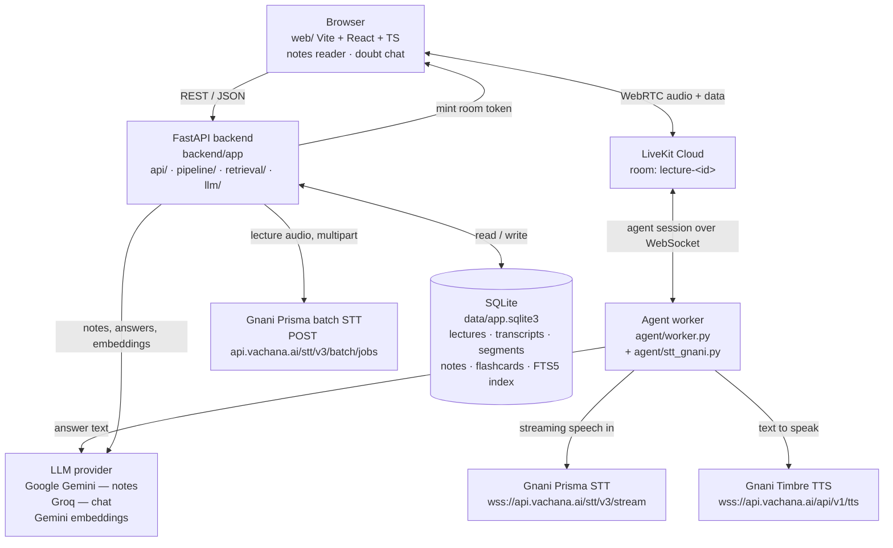

# Architecture

Two paths run through this system, and they are deliberately kept apart:

- **Ingestion** is a batch job. A recording goes to Gnani Prisma's batch
  transcription API, and the transcript becomes structured notes. Nothing
  here is real-time.
- **Conversation** is a live session. A student's speech goes to Gnani
  Prisma's streaming STT, the answer is generated and spoken by Gnani
  Timbre, and LiveKit carries the media.

The two share the retrieval and answering code and the SQLite file. They
share nothing else: different transports, different Gnani endpoints,
different failure handling.

## The diagram

```
                                 ┌───────────────────────────────────────────┐
                                 │  Browser  (web/ — Vite + React + TS)      │
                                 │  Screen A: notes reader                   │
                                 │  Screen B: doubt chat + flashcards        │
                                 └───────┬───────────────────────┬───────────┘
                                         │                       │
                       REST / JSON        │                       │  WebRTC audio
        (same origin in prod, Vite proxy  │                       │  + room data
                       in dev, port 5173) │                       │
                                         v                       v
  ┌────────────────────────────────────────────┐   ┌──────────────────────────┐
  │  FastAPI backend  (backend/app)            │   │  LiveKit Cloud           │
  │  ─────────────────────────────────────     │   │  (wss://<project>.livekit │
  │  api/lectures  api/chat  api/flashcards    │   │   .cloud)                │
  │  api/livekit    api/health  api/ready      │   │                          │
  │  ─────────────────────────────────────     │   │  room: lecture-<id>      │
  │  pipeline/  ingest → transcribe → segment   │   └───────┬──────────┬───────┘
  │             → note → merge                   │           │          │
  │  retrieval/ fts5 + embeddings → rerank       │   room token│          │ WebSocket
  │  llm/        provider-neutral model access   │   (minted   │          │ (agent session)
  └──────┬──────────────┬──────────────┬────────┘   server-  │          │
         │              │              │            side)    │          │
         │              │              │                    v          v
         │              │              │            ┌──────────────────────┐
         │              │              │            │  Agent worker       │
         │              │              │            │  (agent/worker.py)  │
         │              │              │            │  LiveKit Agent      │
         │              │              │            │  + stt_gnani.py     │
         │              │              │            └───┬──────────┬──────┘
         │              │              │                │          │
         │              │              │  speech       │          │  speech
         │              │              v  (WebSocket)  v          v  (WebSocket)
         │              │   ┌────────────────────────┐  ┌────────────────────┐
         │              │   │  Gnani Prisma STT      │  │  Gnani Timbre TTS  │
         │              │   │  wss://api.vachana.ai/ │  │  wss://api.vachana.│
         │              │   │       stt/v3/stream    │  │  ai/api/v1/tts     │
         │              │   └────────────────────────┘  └────────────────────┘
         │              │
         │              │   ┌──────────────────────────────────────────────┐
         │              │   │  LLM provider                              │
         │              │   │  Google Gemini  (workload A — notes)        │
         │              │   │  Groq            (workload B — chat)       │
         │              │   │  Gemini embeddings (retrieval index)         │
         │              │   │  generativelanguage.googleapis.com        │
         │              │   │  api.groq.com/openai/v1                    │
         │              │   └──────────────────────────────────────────────┘
         │              │
         │              │   ┌──────────────────────────────────────────────┐
         │              └──▶  Gnani Prisma batch STT                     │
         │                  POST https://api.vachana.ai/stt/v3/batch/jobs│
         │                  (lecture audio, multipart, ≤10 MB per file)  │
         │                  └──────────────────────────────────────────────┘
         │
         │                  ┌──────────────────────────────────────────────┐
         └─────────────────▶  SQLite  (data/app.sqlite3)                 │
                            │  lectures · transcripts · segments ·         │
                            │  note_topics · notes · stage_state ·        │
                            │  flashcards · flashcard_reviews ·            │
                            │  credit_usage · segments_fts (FTS5) ·        │
                            │  segment_embeddings                         │
                            └──────────────────────────────────────────────┘
```

The same graph in Mermaid:



Three things the diagram makes explicit:

1. **The LiveKit API secret never leaves the backend.** The browser asks the
   backend for a room token; the backend mints it with the secret and hands
   back a JWT. The browser never sees the secret.
2. **The agent worker is a separate process from the API.** It holds a
   long-lived room session, which does not belong in a request handler.
3. **Every AI call leaves the machine.** The batch path, the streaming STT,
   the LLM and the TTS are four different remote calls in three different
   providers. Only the local LiveKit configuration (C) keeps the media hop
   local, and even then these four calls still cross the WAN.

## Path 1: ingestion (batch)

```
teacher's recording
   │
   ├─ POST /api/lectures/upload  (multipart: file, title, language_code)
   │      ├─ extension gate + magic-byte sniff
   │      ├─ ffprobe: duration, sample rate, channels, codec
   │      └─ size cap: 500 MB / 6 hours
   │
   ├─ ingest
   │      ├─ SHA-256 of the file → the cache key
   │      ├─ transcode to 16 kHz mono MP3   (Prisma is a telephonic model)
   │      ├─ ffmpeg silencedetect → the quietest points
   │      └─ cut chunks on silence, each under 10 MB
   │
   ├─ cache check: SHA-256 + language code + model
   │      └─ HIT  → no Gnani job, no credits  → jump to segmentation
   │
   ├─ transcribe  (POST /stt/v3/batch/jobs → start → poll ≥10 s → files)
   │      └─ per-file timestamps are relative to that file → rebase onto
   │         the chunk offset
   │
   ├─ segment
   │      ├─ normalise the transcript (punctuation, casing) without
   │      │  changing its meaning
   │      ├─ split into topic groups
   │      ├─ 66 fine-grained source segments = the RAG corpus
   │      └─ flag the visual-dependent segments ("ye wala equation")
   │
   ├─ index: embed the source segments (768 dims) into SQLite
   │
   ├─ note: one short note per topic (3–5 sentences, under 120 words)
   │      ├─ model calls are paced 2 s apart, not parallel
   │      ├─ Google primary, Groq fallback on a quota error
   │      └─ merge the notes into one document, with timestamps
   │         derived from the segments each section cites
   │
   └─ GET /api/lectures/{id}/notes → the notes reader
```

Every stage writes its own checkpoint to `stage_state`, and the transcript is
committed to SQLite **before** segmentation starts. A failure in the note
stage therefore leaves a finished transcript behind, and the note stage can
be re-run on its own without spending a single credit.

## Path 2: conversation (live)

```
student speaks
   │
   ├─ browser → LiveKit Cloud (WebRTC) → agent worker
   │
   ├─ LiveKit's own VAD decides the end of the turn
   │      (not the STT: the Gnani server sends speech_start but never
   │       speech_end, so the plugin can only ever emit START_OF_SPEECH)
   │
   ├─ stt_gnani.TunedSpeechStream
   │      ├─ forwards the audio to wss://api.vachana.ai/stt/v3/stream
   │      ├─ adds the four Gnani VAD-tuning headers the plugin does not
   │      │  expose (x-min-silence-ms: 700 among them)
   │      └─ injects 0.8 s of trailing silence as soon as the input goes
   │         quiet, because the server only closes a segment when it hears
   │         silence
   │
   ├─ final transcript → LiveKit commits the turn
   │
   ├─ retrieval: FTS5 (bm25) over the source segments, then the semantic
   │      stage, then the reranker
   │      └─ below the score threshold the answer is "not covered" and the
   │         model is never called
   │
   ├─ LLM: Groq, qwen/qwen3.8-27b, streaming
   │      └─ the answer must cite the excerpt numbers it used; a citation
   │         that names an excerpt which was not in the prompt is rejected
   │
   ├─ TTS: Gnani Timbre, one sentence at a time as the answer streams
   │
   └─ audio → LiveKit Cloud → browser
```

The text chat at `POST /api/chat` uses exactly the same retrieval and
answering code, so a student can type when the microphone is unavailable,
and the demo can be driven from a script.

## Components

| Path | Module | Responsibility |
|---|---|---|
| API | `backend/app/main.py` | The FastAPI app. Mounts the built front end from the same origin |
| API | `backend/app/api/lectures.py` | Upload, list, status, notes |
| API | `backend/app/api/chat.py` | The grounded text chat and the search-only endpoint |
| API | `backend/app/api/flashcards.py` | Flashcards and the SM-2 style review scheduling |
| API | `backend/app/api/livekit.py` | Mints room tokens server-side |
| API | `backend/app/api/health.py` | Liveness, and readiness with the dependency state as data |
| Pipeline | `backend/app/pipeline/orchestrator.py` | The state machine, the transcript cache, the credit ceiling, per-stage resumability |
| Pipeline | `backend/app/pipeline/ingest.py` | Validation, transcode, silence-aware chunking, content hashing |
| Pipeline | `backend/app/pipeline/transcribe.py` | The Gnani batch job lifecycle, bounded retries, timestamp rebasing |
| Pipeline | `backend/app/pipeline/segment.py` | Normalisation, topic segmentation, visual-dependency detection |
| Pipeline | `backend/app/pipeline/notes.py` | Per-segment notes, the merge, the grounding rule, the provider chain |
| Retrieval | `backend/app/retrieval/fts.py` | FTS5 lexical search, merging, the abstention gate |
| Retrieval | `backend/app/retrieval/embeddings.py` | Multilingual embeddings, stored as float32 in SQLite, searched by cosine similarity |
| Retrieval | `backend/app/retrieval/rerank.py` | Grounded answering with citation validation |
| LLM | `backend/app/llm/factory.py` | Provider-neutral access, error classification, the two workload profiles |
| Storage | `backend/app/db.py` | The schema, the versioned migration, the cache key |
| Storage | `backend/app/logging_setup.py` | JSON logs, secret redaction, the collision-safe `makeRecord` |
| Voice | `agent/stt_gnani.py` | A thin extension of the official Gnani plugin: VAD headers and trailing silence |
| Voice | `agent/worker.py` | The LiveKit agent session |
| Voice | `agent/bench/` | The latency benchmark harness |

## The data model

`data/app.sqlite3`, one file, WAL mode, foreign keys on.

| Table | Holds | Rebuilt from the transcript? |
|---|---|---|
| `lectures` | One row per upload: status, duration, language, failure reason | no |
| `transcripts` | The cached Gnani transcript. `content_hash` is UNIQUE | **never** — this is the expensive artefact |
| `segments` | The RAG corpus: fine-grained, timestamped, ordered source spans | yes |
| `note_topics` | The topic groupings, with the range of source segments each covers | yes |
| `notes` | The merged document and its summary | yes |
| `segments_fts` | The FTS5 index over `segments`, kept in step by triggers | yes |
| `segment_embeddings` | 768-dimensional float32 vectors for the semantic stage | yes |
| `stage_state` | Per-stage checkpoints, so a failed stage can be re-run alone | yes |
| `flashcards` / `flashcard_reviews` | The cards and their spaced-repetition state | yes |
| `credit_usage` | The per-day estimated credit accounting | no |

A schema change bumps `schema_version` and drops only the derived tables.
The transcript survives, because losing it would mean paying for the Gnani
job again.

## The lecture state machine

```
uploaded → transcribing → transcribed → segmenting → segmented → noting → ready
    │            │              │            │            │
    └────────────┴──────────────┴────────────┴────────────┴──→ failed
                                                                 │
                                            failed_stage names the stage
```

`failed_stage` is one of `ingest`, `transcribe`, `segment`, `note`. Because
the transcript is committed before segmentation, a `note` failure leaves a
complete transcript and a re-run of that stage costs no credits.

## The decisions the measurements forced

| Decision | The measurement behind it |
|---|---|
| 16 kHz mono MP3 for the batch upload | Prisma is a telephonic model; 16 kHz mono is its input distribution, and it cuts the bytes about fourfold, so there are fewer chunk boundaries where a sentence could break |
| Cut the chunks on silence | A fixed-duration cut lands mid-sentence; a silence-aware cut falls between sentences |
| Rebase every chunk's timestamps | The batch API returns timestamps relative to each file, not to the job. The detector in `transcribe.py` checks this rather than assuming it |
| Pace the model calls 2 s apart, serially | Groq's free tier allows 1000 output tokens per minute; eight parallel notes exhausted the window and made the merge call fail with a 413 |
| Keep the per-segment notes short (3–5 sentences) | The merge call is the largest request in the pipeline, and it is the one that has to fit inside the token budget |
| Classify quota errors separately from rate limits | Google's free tier allows 20 requests per day per model, and its quota error is a 429 — the same status as a per-minute rate limit. A naive retry loop turned 9 needed calls into 24 and burned the day |
| Fall back to Groq for the notes workload | Both providers were already authorised; no new service and no paid plan |
| Tokenize on whitespace and keep combining marks | Python's `\w` drops Indic combining marks, so `પાણી` fragmented and never matched the FTS5 index, which keeps the marks whole |
| Derive the speech end from LiveKit's VAD | The Gnani streaming server sends `speech_start` but never `speech_end`, so the official plugin can only ever emit `START_OF_SPEECH` |
| Inject 0.8 s of trailing silence into the STT | Without silence the server never closes the segment and no transcript is delivered at all. At 0.5 s a 0.6 s pause split the utterance; at 0.8 s it did not |
| Keep the retrieval lexical first, with embeddings as a second stage | The lexical stage needs no second service and no credits, and it is deterministic. A Telugu question retrieved the right segment but an English or Hinglish question retrieved nothing, which is why the semantic stage was added |
| Abstain before calling the model | If retrieval finds nothing that plausibly answers the question, the cheapest and most reliable way to avoid a fabricated answer is not to ask |
